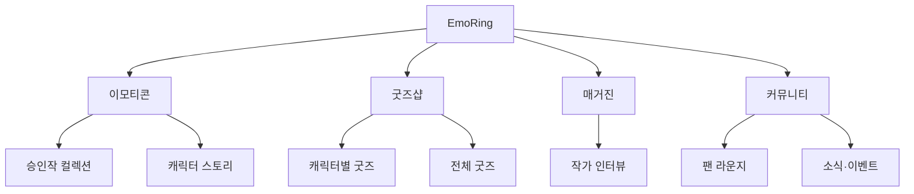

# EmoRing 이모티콘 전문 작가 홈페이지 메뉴 구조 및 페이지 설계서

- 문서명: 메뉴.md
- 브랜드: EmoRing
- 대표 작가: 써니
- 문의 전화: 010-2627-3771
- 문의 이메일: e_iiias@naver.com
- 작성 기준: 사용자 제공 요구사항
- 문서 성격: 홈페이지 제작을 위한 정보 구조·페이지 구성·기능 제안서
- 범위: 대메뉴 4개, 전체 소메뉴 7개. 홈·상세 화면·필터·보조 기능·관리자 기능은 이 개수에 포함하지 않는다.
- 승인 작품 8종의 실제 이름, 이미지, 승인 플랫폼, 판매 링크는 미제공 상태다. 아래 작품 01~08은 입력 자리이며 실제 승인 사실을 새로 확인한 목록이 아니다.
- 이번 요청은 이모티콘 전문 작가 홈페이지로 확정한다. AI 강의 메뉴는 포함하지 않는다.

## 1. 플랫폼의 목적

EmoRing은 써니 작가의 이모티콘 작품을 감상하고, 캐릭터별 굿즈를 구매하며, 인터뷰를 통해 창작 이야기를 읽고, 팬과 작가가 소통하는 플랫폼이다.

브랜드 소개 문구 제안:
“마음을 전하는 이모티콘, 일상으로 이어지는 굿즈.”
“써니의 캐릭터와 팬이 만나는 곳, EmoRing.”

설계의 중심은 작품이다. 작품마다 동일한 작품 식별자를 사용하여 굿즈·매거진·커뮤니티 게시물을 연결한다. 방문자는 좋아하는 작품을 기준으로 관련 콘텐츠를 이어서 탐색할 수 있다.

## 2. 대메뉴 4개·소메뉴 7개 확정표

| 대메뉴 | 소메뉴 번호 | 소메뉴 | 주요 목적 | 권장 경로 |
| --- | --- | --- | --- | --- |
| 이모티콘 | 1 | 승인작 컬렉션 | 승인 작품 8종 소개 및 공식 판매처 연결 | /emoticons/collection |
| 이모티콘 | 2 | 캐릭터 스토리 | 성격·세계관·대표 감정·제작 이야기 소개 | /emoticons/stories |
| 굿즈샵 | 3 | 캐릭터별 굿즈 | 작품 8종별 관련 상품 탐색과 구매 | /shop/characters |
| 굿즈샵 | 4 | 전체 굿즈 | 상품 유형별 탐색과 구매 | /shop/all |
| 매거진 | 5 | 작가 인터뷰 | 써니 소개·인터뷰·창작 과정 | /magazine/interviews |
| 커뮤니티 | 6 | 팬 라운지 | 팬과 작가의 대화·팬아트·사용 후기 | /community/lounge |
| 커뮤니티 | 7 | 소식·이벤트 | 공지·신작·굿즈 출시·팬 참여 이벤트 | /community/news |

개수 검증: 대메뉴 4개, 소메뉴 2+2+1+2=7개.

## 3. 전체 메뉴 트리 구조도

아래 Mermaid는 상위 메뉴와 소메뉴의 부모·자식 관계를 표현한다. Mermaid를 지원하는 편집기에서 트리 형태로 확인할 수 있다.

### 3.1 상세 계층 목록

아래의 3단계 이하 항목은 콘텐츠·화면·기능이다. 별도의 소메뉴로 추가하지 않는다.

1. 이모티콘
   - 승인작 컬렉션
     - 작품 01~08 카드
     - 작품 상세 화면
     - 이모티콘 미리보기
     - 공식 판매처 이동
     - 해당 캐릭터 굿즈
     - 관련 인터뷰·스토리
   - 캐릭터 스토리
     - 작품별 캐릭터 소개
     - 성격·세계관·관계
     - 대표 표정·자주 쓰는 말
     - 스케치와 창작 과정
2. 굿즈샵
   - 캐릭터별 굿즈
     - 작품 01~08 선택
     - 선택한 작품의 굿즈 목록
     - 상품 상세·옵션 선택
   - 전체 굿즈
     - 문구·소품·리빙·패션·디지털 필터
     - 상품 검색·정렬·품절 표시
     - 상품 상세·옵션 선택
3. 매거진
   - 작가 인터뷰
     - 써니 작가 소개
     - 인터뷰 기사 목록
     - 기사 상세
     - 관련 작품·굿즈·팬 질문 연결
4. 커뮤니티
   - 팬 라운지
     - 자유 이야기·팬아트·후기·작가에게 질문 태그
     - 게시물 목록·상세
     - 글쓰기·댓글·답글·신고
   - 소식·이벤트
     - 공지·신작 소식·굿즈 출시·이벤트 태그
     - 게시물 상세
     - 이벤트 참여·결과 안내

## 4. 공통 내비게이션과 보조 기능

### 4.1 PC 헤더

- 왼쪽: EmoRing 로고. 클릭하면 홈으로 이동한다.
- 가운데: 이모티콘 / 굿즈샵 / 매거진 / 커뮤니티.
- 오른쪽: 검색 / 로그인 또는 마이페이지 / 장바구니.
- 대메뉴를 클릭하면 첫 번째 소메뉴로 이동한다.
- 펼침 버튼은 대메뉴 링크와 구분한다. 클릭·키보드로도 소메뉴를 열 수 있게 한다.
- 현재 대메뉴와 소메뉴의 선택 상태를 표시한다.
- 상세 페이지에는 “홈 > 굿즈샵 > 캐릭터별 굿즈 > 상품명”과 같은 현재 위치를 표시한다.

### 4.2 모바일 헤더

- 왼쪽 로고, 오른쪽 검색·장바구니·전체메뉴 버튼.
- 전체메뉴를 열면 대메뉴 4개와 소메뉴 7개를 아코디언으로 보여준다.
- 메뉴 닫기, 배경 터치 닫기, 키보드 포커스 이동을 지원한다.
- 상품 상세에서는 화면 하단에 옵션 선택·구매 버튼을 고정하되 본문을 가리지 않는다.

### 4.3 메뉴 개수에서 제외하는 보조 페이지

| 기능 | 내용 | 진입 위치 |
| --- | --- | --- |
| 홈 | 플랫폼 전체 소개와 주요 콘텐츠 | 로고 |
| 통합 검색 | 작품·굿즈·매거진·공개 게시물 검색 | 헤더 |
| 로그인·회원가입 | 회원 인증 및 기본 정보 | 헤더 |
| 마이페이지 | 주문·배송·찜·내 글·계정 설정 | 헤더 |
| 장바구니·주문·결제 | 구매할 상품 확인과 결제 | 헤더·상품 화면 |
| 고객지원 | 배송·교환·반품 안내, 비공개 문의 | 푸터·주문 화면 |
| 약관·개인정보 안내 | 실제 운영 정책 안내 | 푸터 |

보조 페이지는 다섯 번째 대메뉴 또는 여덟 번째 소메뉴로 표시하지 않는다.

## 5. 홈 화면 구성

홈 경로: /

| 순서 | 영역 | 구체적인 구성 | 주요 이동 버튼 |
| --- | --- | --- | --- |
| 1 | 메인 소개 | 써니의 대표 캐릭터, EmoRing 소개, 짧은 환영 문구 | 작품 만나기 / 굿즈 구경하기 |
| 2 | 승인작 8종 | PC 4열×2행, 태블릿 2열×4행, 모바일 2열 기본 | 작품별 상세 보기 |
| 3 | 캐릭터별 굿즈 | 8개 작품 선택 칩, 선택 작품의 판매 상품 | 이 캐릭터 굿즈 전체 보기 |
| 4 | 추천 굿즈 | 작가가 선정한 실제 판매 상품 4~8개 | 전체 굿즈 보기 |
| 5 | 써니 인터뷰 | 대표 사진 또는 작업 이미지, 제목, 짧은 소개 | 인터뷰 읽기 |
| 6 | 팬 라운지 | 공개 게시물 최근 목록, 작가 답글 표시 | 팬 라운지 참여하기 |
| 7 | 소식·이벤트 | 공개 중인 공지와 이벤트, 진행 기간 | 소식 더 보기 |
| 8 | 푸터 | 작가·문의·운영 정보·고객지원 | 전화 / 이메일 문의 |

운영 규칙:
- 첫 화면에서 브랜드명, 작가명, 작품 중심 플랫폼이라는 점이 드러나야 한다.
- 실제 판매 데이터가 없으면 “베스트셀러” 대신 “써니의 추천 굿즈”를 사용한다.
- 판매 상품이 없는 캐릭터는 “굿즈 준비 중”으로 표시한다.
- 없는 리뷰 수·판매량·팬 수·수상 이력은 임의로 넣지 않는다.
- 이미지 미등록 상태를 보여주는 내부 자리표시자를 실제 판매 이미지처럼 게시하지 않는다.

## 6. 소메뉴 1: 승인작 컬렉션

### 6.1 목록 화면

페이지 제목: “써니의 이모티콘 컬렉션”
소개 문구: “대화 속 마음을 전하는 써니의 캐릭터들을 만나보세요.”

작품 카드 구성:
- 대표 캐릭터 이미지
- 실제 작품명
- 한 줄 콘셉트
- 승인 플랫폼·판매 상태
- 감정 또는 사용 상황 태그 2~3개
- “작품 보기” 버튼

‘승인’과 ‘판매 중’은 다른 상태다. 승인 후 출시 대기 중인 작품에는 판매 중 표시나 구매 버튼을 붙이지 않는다.

### 6.2 승인 작품 8종 등록 자리

| 관리 번호 | 작품명 | 콘셉트 | 필수 이미지 | 승인 정보 | 연결 대상 |
| --- | --- | --- | --- | --- | --- |
| 작품 01 | 실제 작품명 입력 | 실제 콘셉트 입력 | 대표 이미지·미리보기 | 플랫폼·상태 확인 | 스토리·굿즈·기사 |
| 작품 02 | 실제 작품명 입력 | 실제 콘셉트 입력 | 대표 이미지·미리보기 | 플랫폼·상태 확인 | 스토리·굿즈·기사 |
| 작품 03 | 실제 작품명 입력 | 실제 콘셉트 입력 | 대표 이미지·미리보기 | 플랫폼·상태 확인 | 스토리·굿즈·기사 |
| 작품 04 | 실제 작품명 입력 | 실제 콘셉트 입력 | 대표 이미지·미리보기 | 플랫폼·상태 확인 | 스토리·굿즈·기사 |
| 작품 05 | 실제 작품명 입력 | 실제 콘셉트 입력 | 대표 이미지·미리보기 | 플랫폼·상태 확인 | 스토리·굿즈·기사 |
| 작품 06 | 실제 작품명 입력 | 실제 콘셉트 입력 | 대표 이미지·미리보기 | 플랫폼·상태 확인 | 스토리·굿즈·기사 |
| 작품 07 | 실제 작품명 입력 | 실제 콘셉트 입력 | 대표 이미지·미리보기 | 플랫폼·상태 확인 | 스토리·굿즈·기사 |
| 작품 08 | 실제 작품명 입력 | 실제 콘셉트 입력 | 대표 이미지·미리보기 | 플랫폼·상태 확인 | 스토리·굿즈·기사 |

실제 작품 자료를 받기 전에는 위 8종에 임의 이름을 붙여 승인작이라고 소개하지 않는다.

### 6.3 작품 상세 화면

권장 경로: /emoticons/collection/{collectionId}

화면 순서:
1. 작품명·대표 이미지·한 줄 소개.
2. 플랫폼과 출시·판매 상태.
3. 대표 이모티콘 미리보기. 원본 비율과 이미지 내 문구를 보존한다.
4. 캐릭터의 성격과 사용 상황.
5. “공식 판매처에서 보기” 버튼. 검증된 링크가 있을 때만 노출한다.
6. 같은 작품의 굿즈.
7. 해당 캐릭터 스토리와 관련 인터뷰.
8. 팬 라운지의 해당 작품 게시물 보기.

## 7. 소메뉴 2: 캐릭터 스토리

목적: 작품의 세계관과 감정에 공감하고 캐릭터를 기억하게 한다.

목록은 작품 8종을 스토리 카드로 보여준다. 상세 경로는 /emoticons/stories/{collectionId}로 한다.

상세 내용:
- 캐릭터 이름과 대표 장면
- 탄생 배경
- 성격 키워드 3개
- 좋아하는 것·싫어하는 것
- 주로 표현하는 감정
- 대표 대사와 표정
- 작가의 스케치·메모·제작 과정
- 관련 이모티콘과 굿즈 링크

위 항목은 실제 설정을 입력하는 템플릿이다. 없는 설정이나 실제로 하지 않은 작가 발언을 사실처럼 작성하지 않는다.
스토리가 준비되지 않은 작품은 공개 목록에서 숨기거나 준비 중 상태를 명확히 표시한다.

## 8. 소메뉴 3: 캐릭터별 굿즈

목적: “이 캐릭터가 좋아요”라는 관심을 해당 캐릭터 상품 탐색으로 연결한다.

### 8.1 탐색 구조

- 상단에 전체와 작품 01~08 선택 칩을 배치한다.
- 작품 칩에는 작은 캐릭터 이미지와 실제 작품명을 함께 표시한다.
- 작품 선택 시 해당 작품에 연결된 상품만 표시한다.
- 선택 상태는 주소의 필터 값에 저장해 새로고침·공유·뒤로가기를 지원한다.
- 굿즈가 없는 작품도 선택 가능하게 하고 “이 캐릭터의 굿즈를 준비하고 있어요”를 표시한다.

### 8.2 상품 구성 제안

다음은 판매 품목 제안이며 판매 확정 목록이 아니다.

| 상품 유형 | 제안 품목 | 등록할 주요 정보 |
| --- | --- | --- |
| 문구 | 스티커·메모지·엽서·노트 | 크기·매수·종이·인쇄 방식 |
| 소품 | 아크릴 키링·스마트톡·뱃지 | 소재·크기·부착 방식 |
| 리빙 | 머그컵·쿠션·코스터 | 소재·용량 또는 크기·관리 방법 |
| 패션 | 에코백·파우치·티셔츠 | 소재·사이즈·색상·세탁 방법 |
| 디지털 | 배경화면·디지털 스티커 | 파일 형식·해상도·사용 범위 |

캐릭터별로 실제 판매 가능한 품목만 게시한다. 여러 캐릭터가 포함된 상품은 여러 작품에 연결할 수 있다.

### 8.3 상품 상세 화면

공통 경로: /shop/products/{productId}. 캐릭터별·전체 굿즈에서 같은 상품 상세를 사용한다.

구성:
1. 상품 사진 갤러리.
2. 상품명·캐릭터명·가격·판매 상태.
3. 옵션·수량·현재 구매 금액.
4. 장바구니 담기·구매하기·찜하기.
5. 상세 설명·소재·크기·구성품·주의사항.
6. 배송비·출고 일정·교환 및 반품 안내.
7. 구매 후기와 상품 문의.
8. 같은 캐릭터의 다른 상품.
9. 원작 이모티콘 소개.

품절 옵션은 구매할 수 없게 한다. 주문제작 상품은 제작 기간을 별도로 표시한다.
디지털 상품은 배송지 입력 대신 수령·다운로드 안내를 사용한다.
가격·할인·재고·배송비는 실제 운영값을 사용하며 예시값을 실제 판매값으로 노출하지 않는다.

## 9. 소메뉴 4: 전체 굿즈

- 전체 상품을 통합해 보여준다.
- 필터: 작품, 상품 유형, 가격 범위, 판매 가능 여부.
- 정렬: 최신순, 낮은 가격순, 높은 가격순.
- 판매순·후기순은 실제 집계가 있을 때만 제공한다.
- 검색 대상: 상품명, 작품명, 공개 상품 설명.
- 결과 개수와 적용한 필터를 함께 표시한다.
- “필터 초기화” 버튼을 제공한다.
- 결과가 없으면 조건 해제 또는 다른 작품 탐색을 안내한다.

상품 카드에는 이미지·상품명·작품명·가격·품절 여부를 표시한다.
할인율은 실제 정상가와 판매가에 근거해 계산한다.
상품 유형은 이 화면의 필터이며 추가 소메뉴가 아니다.

## 10. 소메뉴 5: 작가 인터뷰

### 10.1 목록 화면

페이지 제목: “써니의 창작 노트”
소개 문구 제안: “작은 표정 하나에 담긴, 작가의 큰 이야기.”

- 상단: 써니 작가 프로필과 소개.
- 대표 인터뷰 1개를 크게 배치한다.
- 아래에 인터뷰·작업실 이야기·제작 과정 기사를 카드로 배치한다.
- 카드 항목: 표지 이미지, 제목, 짧은 요약, 발행일.
- 기사 유형은 태그이며 별도의 소메뉴로 만들지 않는다.

### 10.2 기사 상세

권장 경로: /magazine/interviews/{articleId}

- 제목·요약·작성자·발행일
- 대표 이미지와 필요한 이미지 설명
- 도입 글
- 질문·답변 본문
- 스케치·작업 이미지
- 관련 작품과 굿즈
- “작가에게 질문하기” 버튼: 팬 라운지의 질문 작성 화면으로 이동
- 이전·다음 기사

### 10.3 첫 인터뷰 질문 제안

1. 써니라는 작가명에는 어떤 이야기가 있나요?
2. 이모티콘을 만들기 시작한 계기는 무엇인가요?
3. 첫 승인 소식을 들었을 때 어떤 마음이었나요?
4. 작품 8종은 각각 어떤 감정과 상황에서 출발했나요?
5. 캐릭터의 표정과 대사는 어떻게 정하나요?
6. 이모티콘을 굿즈로 만들 때 가장 중요하게 생각하는 것은 무엇인가요?
7. 팬들에게 듣고 싶은 이야기와 전하고 싶은 말은 무엇인가요?
8. 앞으로 EmoRing에서 어떤 경험을 선보이고 싶나요?

답변은 작가가 제공한 실제 내용으로 채운다. 허구의 인터뷰를 실제 발언처럼 게재하지 않는다.

## 11. 소메뉴 6: 팬 라운지

### 11.1 게시판 구성

페이지 제목: “써니와 팬들의 이야기”
상단에 환영 문구·이용 안내·글쓰기 버튼을 표시한다.

태그:
- 자유 이야기
- 팬아트
- 굿즈 후기
- 작가에게 질문

작품 8종 필터를 함께 제공한다. 태그·필터는 소메뉴에 포함하지 않는다.

### 11.2 목록과 상세

목록: 태그·작품·제목·작성자 닉네임·작성일·댓글 수·작가 답글 여부.
상세: 본문·첨부 이미지·관련 작품·댓글·답글·신고.
작가 본인 계정에만 “작가 써니” 배지를 표시한다.

### 11.3 작성과 참여

- 비회원: 공개 글 읽기.
- 로그인 회원: 글쓰기·댓글·답글·공감·신고.
- 작성자: 본인 글 수정·삭제.
- 작가·관리자: 답변·고정·공지 연결·신고 처리.
- 이미지 업로드 시 파일 크기·형식·미리보기를 안내한다.
- 글에는 작품 연결을 선택 사항으로 제공한다.
- 개인정보가 포함되는 배송·결제 문의는 비공개 고객지원으로 연결한다.

### 11.4 운영 원칙

- 욕설·도배·불법 광고·무단 도용을 제한하는 이용 규칙을 게시한다.
- 게시물 숨김·삭제 사유와 처리 기록을 관리한다.
- 팬아트를 별도 상품이나 홍보물로 활용할 때에는 사용 범위를 별도로 확인한다.
- 굿즈 후기의 “구매 확인” 표시는 해당 상품 구매 기록이 확인된 경우만 표시한다.
- 작가 답글이 없는 상태를 “답변 완료”로 표시하지 않는다.
- 글이 없으면 첫 글 작성 안내를 보여준다.

## 12. 소메뉴 7: 소식·이벤트

태그: 공지사항 / 신작 소식 / 굿즈 출시 / 이벤트.

상세 화면:
- 제목·태그·게시일
- 본문·안내 이미지
- 관련 작품과 상품
- 이벤트 기간·참여 대상·참여 방법
- 결과 발표 일정·안내 방식
- 진행 상태: 예정 / 진행 중 / 종료

이벤트 참여는 게시물 내 버튼 또는 참여 양식으로 구현한다.
기간이 지난 이벤트에는 참여 버튼을 비활성화한다.
필요한 개인정보는 비공개 방식으로 받으며 공개 댓글에 연락처를 남기도록 요구하지 않는다.
취소·일정 변경 시 기존 내용을 조용히 덮어쓰지 않고 변경 안내를 남긴다.

## 13. 콘텐츠 연결 원칙

| 출발 화면 | 연결 화면 | 사용자가 할 수 있는 행동 |
| --- | --- | --- |
| 승인작 상세 | 공식 이모티콘 판매처 | 원작 구매 또는 확인 |
| 승인작 상세 | 해당 캐릭터 굿즈 | 좋아하는 작품의 상품 찾기 |
| 캐릭터 스토리 | 승인작 상세 | 설정과 실제 작품 함께 보기 |
| 굿즈 상세 | 원작 상세 | 상품의 캐릭터 이해하기 |
| 인터뷰 | 관련 작품·상품 | 창작 이야기에서 탐색 이어가기 |
| 인터뷰 | 팬 라운지 | 작가에게 질문하기 |
| 팬 라운지 | 관련 작품·상품 | 팬 대화에서 작품 확인하기 |
| 소식·이벤트 | 대상 작품·상품·참여 화면 | 소식 확인 후 참여하기 |

관련 대상이 없거나 비공개이면 빈 링크를 표시하지 않는다.
작품을 삭제하더라도 주문 이력의 상품명·옵션·결제 금액 기록은 유지한다.

## 14. 구매 흐름과 마이페이지

구매 흐름:
1. 캐릭터 또는 상품 유형으로 탐색.
2. 상품 상세 확인.
3. 옵션·수량 선택.
4. 장바구니 확인 또는 바로 구매.
5. 주문자·배송 정보 확인.
6. 최종 금액·배송비 확인 후 결제.
7. 주문 완료와 주문번호 안내.
8. 마이페이지에서 주문·배송·문의 확인.

초기 운영은 회원 구매를 기본 제안으로 한다. 비회원 구매는 운영 방식 결정 후 추가한다.
주문 상태는 결제 대기·결제 완료·제작 또는 준비 중·배송 중·배송 완료·취소·환불로 구분한다.
디지털 상품은 결제 완료 후 이용 가능한 다운로드 내역을 제공한다.
결제 실패·중복 클릭·재고 부족 상황에서는 주문 성공으로 표시하지 않는다.

마이페이지 구성:
- 주문·배송 내역
- 디지털 구매 내역
- 찜한 작품·상품
- 내가 쓴 글·댓글
- 상품 문의·고객지원
- 회원 정보와 계정 설정

위 항목은 회원 보조 화면 안의 기능이며 공개 소메뉴 7개에 포함하지 않는다.

## 15. 관리자 운영 구조

관리자는 일반 방문자용 메뉴와 분리한다.

| 관리 영역 | 세부 작업 |
| --- | --- |
| 작품 관리 | 8종 등록·수정·정렬, 승인 정보·판매 링크·공개 상태 |
| 스토리 관리 | 캐릭터 설정·스케치·연결 작품 편집 |
| 상품 관리 | 작품 연결·사진·옵션·재고·가격·배송·판매 상태 |
| 주문 관리 | 결제 상태 확인·출고·배송·취소·환불 처리 |
| 매거진 관리 | 인터뷰 작성·미리보기·공개·비공개 |
| 커뮤니티 관리 | 게시글·댓글·신고·고정·작가 배지 |
| 소식 관리 | 공지·출시 소식·이벤트 기간·상태 |
| 회원 관리 | 회원 상태·문의 이력·권한 |
| 홈 관리 | 대표 작품·추천 굿즈·대표 인터뷰·배너 |
| 운영 지표 | 기간별 주문·매출·취소·환불·재고 현황 |

관리자 권한은 화면을 숨기는 것뿐 아니라 실제 조회·수정 요청에서도 확인한다.
매출은 결제 완료 금액, 취소·환불 금액, 배송비 포함 여부 등 집계 기준을 표시한다.
방문자 수 등 측정하지 않은 지표는 0으로 추정해 표시하지 말고 “집계 미연결”로 구분한다.

## 16. 콘텐츠 등록 항목

| 콘텐츠 | 필수 항목 | 연결 항목 |
| --- | --- | --- |
| 작품 | 식별자·이름·대표 이미지·한 줄 콘셉트·공개 상태 | 승인 정보·판매처·스토리 |
| 굿즈 | 식별자·상품명·사진·가격·옵션·재고·판매 상태 | 하나 이상의 작품 식별자 |
| 인터뷰 | 식별자·제목·요약·표지·본문·발행일·공개 상태 | 관련 작품·상품 |
| 팬 게시물 | 식별자·작성자·제목·본문·태그·작성일 | 선택 작품 |
| 소식 | 식별자·제목·본문·유형·공개 상태 | 관련 작품·상품 |
| 이벤트 | 기간·참여 방식·진행 상태 | 소식 게시물 |
| 주문 | 주문번호·주문자·상품 및 옵션 내역·결제 상태·금액 | 구매 당시 상품 정보 보관 |

작품명만 문자열로 비교해 관련 상품을 찾지 않는다. 변경되지 않는 식별자를 사용한다.
비공개 콘텐츠와 삭제된 콘텐츠는 일반 검색 결과에서 제외한다.

## 17. 공통 화면 제작 기준

이번 문서는 메뉴와 정보 구조가 중심이며, 특정 참고 이미지의 색상이나 레이아웃을 재현한 디자인 명세가 아니다.

- 캐릭터 이미지가 중심이 되도록 작품 카드와 상품 카드의 크기·정렬을 통일한다.
- 작품 카드는 전체 캐릭터가 보이게 하고, 상품 사진은 실제 상품 식별을 우선한다.
- 이미지 안의 글자·얼굴·주요 소품을 임의로 자르지 않는다.
- 긴 작품명은 제목 영역을 확보해 읽을 수 있게 한다.
- 본문과 버튼은 충분한 대비와 읽기 쉬운 크기를 확보한다.
- 색상만으로 품절·선택·종료 상태를 구분하지 않는다.
- 버튼은 모바일에서 누르기 쉬운 최소 44px 정도의 터치 영역을 목표로 한다.
- 이미지에 내용에 맞는 대체 텍스트를 제공한다.
- 동작 효과는 과하지 않게 적용하고 움직임 축소 설정을 고려한다.
- 목록 복귀 시 검색어·필터·가능한 스크롤 위치를 유지한다.
- 로딩·데이터 없음·오류·권한 없음 상태를 서로 다르게 안내한다.
- 전화·이메일은 모바일에서 바로 연결되게 한다.

## 18. 푸터와 작가 연락처

표시 문안:

EmoRing  
이모티콘 작가 써니  
이모티콘 · 캐릭터 굿즈 · 작가 인터뷰 · 팬 커뮤니티  
문의 전화: 010-2627-3771  
문의 이메일: e_iiias@naver.com

연결:
- 전화: tel:01026273771
- 이메일: mailto:e_iiias@naver.com

푸터 링크:
- 배송·교환·반품 안내
- 고객 문의
- 이용약관
- 개인정보처리방침

사업자명·사업자등록번호·주소·통신판매업 관련 정보·운영 시간은 제공되지 않았다. 실제 운영 정보를 확인한 뒤 입력한다.
본 문서는 운영 정책이나 법적 고지의 확정 문안이 아니다.

## 19. 제작 완료 확인표

- [ ] 공개 대메뉴는 정확히 4개다.
- [ ] 공개 소메뉴는 정확히 7개다.
- [ ] 홈은 로고로 접근하며 별도 대메뉴를 차지하지 않는다.
- [ ] 작품 8종은 승인작 컬렉션 내부에 배치된다.
- [ ] 실제 작품명·이미지·승인 및 판매 상태가 입력되었다.
- [ ] 각 작품에서 해당 굿즈로 이동할 수 있다.
- [ ] 굿즈가 없는 작품에는 준비 중 안내가 있다.
- [ ] 캐릭터별·전체 굿즈는 동일한 상품 상세를 사용한다.
- [ ] 써니의 소개와 실제 인터뷰를 읽을 수 있다.
- [ ] 회원이 글과 댓글로 소통할 수 있다.
- [ ] 작가 답글은 검증된 작가 계정으로 구분된다.
- [ ] 상품 가격·재고·결제·배송 상태가 실제 정보와 일치한다.
- [ ] 공개 문의에 주문자 개인정보가 노출되지 않는다.
- [ ] 모바일에서 메뉴·필터·구매 기능을 사용할 수 있다.
- [ ] 푸터의 작가명·전화·이메일이 정확하다.

## 20. 제작자에게 전달할 실행 지침

EmoRing이라는 이모티콘 전문 작가 홈페이지를 제작한다. 대표 작가는 써니다. 대메뉴는 이모티콘, 굿즈샵, 매거진, 커뮤니티의 4개로 고정한다. 소메뉴는 승인작 컬렉션, 캐릭터 스토리, 캐릭터별 굿즈, 전체 굿즈, 작가 인터뷰, 팬 라운지, 소식·이벤트의 총 7개로 고정한다. 홈에는 승인 작품 8종, 캐릭터별 굿즈, 추천 상품, 써니 인터뷰, 팬 게시물, 소식·이벤트를 배치한다. 각 작품과 관련 굿즈·스토리·인터뷰·팬 게시물을 식별자로 연결한다. 작품 8종의 실제 자료가 전달되기 전에는 입력 자리를 사용하고, 임의의 작품을 승인작이라고 표현하지 않는다. 로그인·마이페이지·장바구니·결제·고객지원은 보조 기능으로 구성하고 대메뉴와 소메뉴 개수에 포함하지 않는다. 문의 전화는 010-2627-3771, 이메일은 e_iiias@naver.com으로 표시한다. 본 문서의 화면 구성, 상태 처리, 등록 항목과 완료 확인표에 따라 구현한다.

